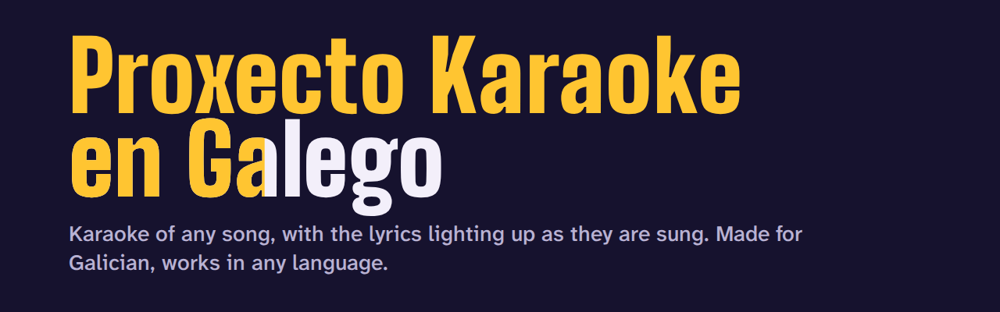
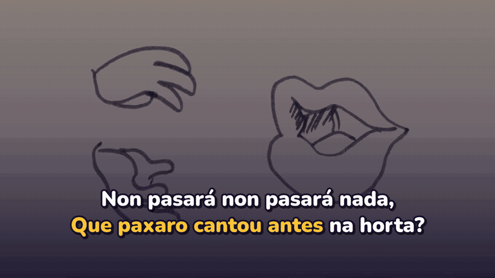
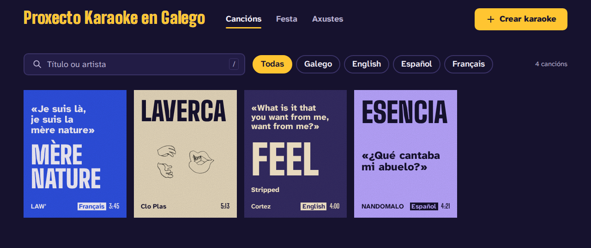
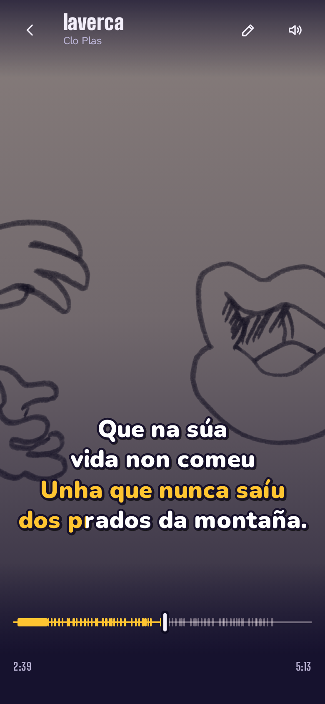
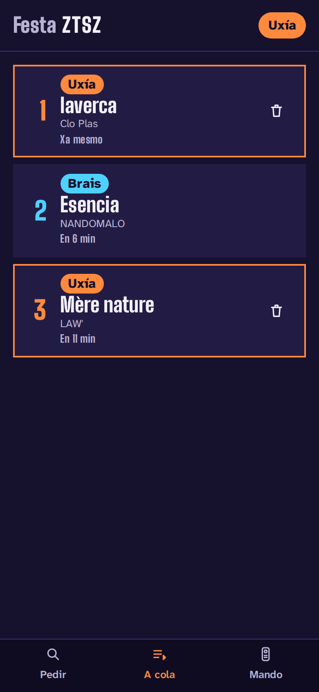
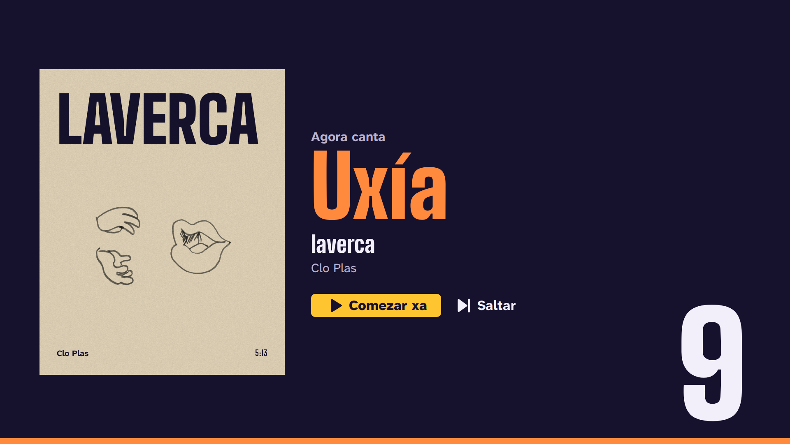
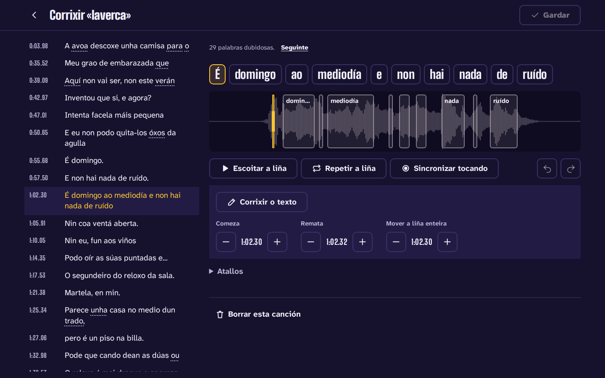
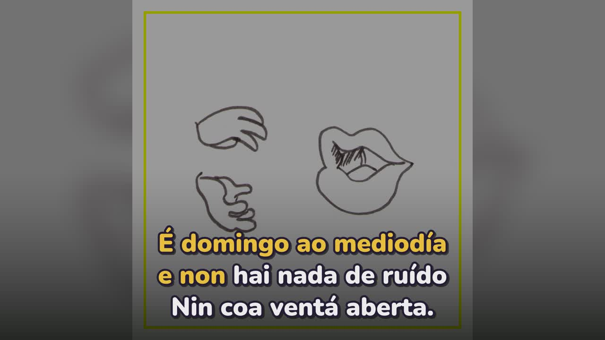
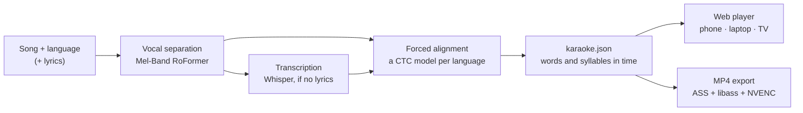

<p align="center">
  
</p>

<p align="center">
  <a href="README.md">Galego</a> | <b>English</b> | <a href="README.es.md">Español</a>
</p>

<p align="center">
  <a href="https://github.com/gaelfernandez1/KaraokeProject/actions/workflows/ci.yml"></a>
  <a href="https://github.com/gaelfernandez1/KaraokeProject/releases"></a>
  <a href="LICENSE"></a>
  
</p>

**Proxecto Karaoke en Galego** ("Galician Karaoke Project") turns any song into a karaoke whose
lyrics light up word by word, syllable by syllable, exactly as they are sung. It runs on your own
computer with a modest GPU, and you sing from your phone, your laptop or the TV. It was built for
**Galician first** — a language that general-purpose tools often mistake for Spanish or Portuguese
— and it **works with songs in any language**.

<p align="center">
  
  <br>
  <sub>“laverca” by Clo Plas (CC BY-SA 4.0), timed by the project with no manual correction.</sub>
</p>

## What it does

- **Make a karaoke from any song**: upload a file or paste a link, choose the language and, if you
  have them, paste the lyrics; otherwise they can be looked up on LRCLIB or transcribed. With
  lyrics, a song is ready in about a minute and a half.
- **Lyrics exactly on time**: every word and syllable gets the moment it is really sung, measured
  against the voice itself; backing vocals get their own lines and each singer their colour.
- **Galician first**: the language you choose is the one used, never switched behind your back;
  dialect and reintegrationist spelling are shown as written, and the pronouns that lyrics sites
  write apart are joined to their verb.
- **Any other language**: Spanish, Portuguese, English, French and German have their own models,
  and every other language — some 1,600 — is aligned with a multilingual model. Without lyrics, it
  transcribes about a hundred languages.
- **Sing anywhere**: a full-screen player that works the same on a phone, a laptop and a TV over
  HDMI, with guide vocals, pitch, delay compensation for TVs and Bluetooth speakers, and songs
  saved for offline use.
- **Party mode**: the TV shows a QR code; guests ask for songs from their phones, take turns and
  use the phone as a remote. Nothing to install.
- **Fix it in seconds**: a lyrics and timing editor flags doubtful words, plays a line back and
  lets you tap along to re-time it, without processing the song again.
- **Export video**: 16:9 for the TV or YouTube and 9:16 for social media, with the same lyrics.
- **Private and free**: everything runs on your computer; no account, no cloud, no fees.

| Library | On the phone | Party: a guest's phone |
|---|---|---|
|  |  |  |

| Party on the TV | Lyrics editor | Video export |
|---|---|---|
|  |  |  |

The app's interface is in Galician, Spanish and English.

## How well it works

Measured with the project's benchmark of freely licensed songs on an RTX 3050 Laptop GPU (4 GB):

| | Result |
|---|---|
| Timing with lyrics, [JamendoLyrics MultiLang](https://github.com/f90/jamendolyrics) (79 songs in English, Spanish, French and German) | **98.8 %** of words start within 0.3 s of the reference; mean error 0.093 s ([report](bench/results/2026-10-29-c4-default-jamendo-lyrics/report.md)) |
| Timing with lyrics, Galician songs | **99.8 %** within 0.3 s ([report](bench/results/2026-11-06-c9-despois-gl-lyrics/report.md)) |
| Transcription without lyrics (word error rate) | 23.2 % on JamendoLyrics, 26.5 % in Galician, down from 33.7 % and 35.9 % for a Demucs + Whisper baseline |
| Language switched without asking | never, in the whole benchmark |
| A 4:47 song with lyrics, from file to karaoke | about 85 s |
| A 4-minute 1080p MP4 | under a minute |

How the benchmark works and every report: [`docs/benchmark.md`](docs/benchmark.md) and
[`bench/results/`](bench/results/).

## How it works



The **engine** separates the vocals, transcribes them when there are no lyrics, and aligns the
lyrics to the voice with a model for each language (Proxecto Nós for Galician; Meta's
Omnilingual for any of the some 1,600 without one of their own). The result is one document,
`karaoke.json`, that the **web player** and the **video export** draw in the same way. A **home
server** queues the jobs on the GPU, keeps the library and serves the app to every device in the
house. Every model was chosen with the benchmark, and each step fits in 4 GB of video memory.

Python 3.12 (uv, FastAPI, PyTorch, faster-whisper), TypeScript (SvelteKit, Web Audio), ffmpeg.
The architecture and the reasoning behind each decision: [`docs/architecture.md`](docs/architecture.md).

## Quick start

You need Linux or Windows 11 with WSL 2 (Ubuntu), Node 22 or newer and ffmpeg. An NVIDIA GPU with
4 GB is recommended; without one it works, more slowly.

```bash
git clone https://github.com/gaelfernandez1/KaraokeProject.git
cd KaraokeProject
make install      # the engine, the server, the web app and the Galician models
make serve
```

Then open <http://localhost:8765>. `make install` can be run again at any time, never uses sudo
and ends by telling you what is still missing. To reach it from phones and the TV, and from
outside home, see [`docs/server.md`](docs/server.md).

From the command line:

```bash
uv run karaoke make cancion.mp3 --lyrics letra.txt --lang gl    # a karaoke package
uv run karaoke make song.mp3 --lyrics lyrics.txt --lang en      # in any other language
uv run karaoke render <package> --aspect 9:16                   # a vertical video
```

## Documentation

The index of the technical guides is [`docs/README.md`](docs/README.md). The planning documents
and design decisions are in Spanish.

- [Architecture](docs/architecture.md) and [design decisions](docs/plan-v3/decisiones/)
- [Development setup](docs/development.md) and [quality gates](docs/quality.md)
- [Server](docs/server.md), [web app](docs/web.md), [audio](docs/audio.md), [lyrics timing](docs/lyrics-sync.md), [animated lyrics](docs/subtitles.md), [video](docs/video.md)
- [Benchmark](docs/benchmark.md) and [languages and models](docs/languages-and-models.md)
- [Releasing](docs/releasing.md) and the [changelog](CHANGELOG.md)

## Status and limits

Version 3.0 is a full rebuild. What it does not do yet:

- It needs Linux or WSL 2; there is no native Windows or macOS version.
- Singers are told apart only when the lyrics say who sings; there is no automatic speaker
  detection yet.
- Without lyrics, Galician transcription still gets about one word in four wrong: pasting the
  lyrics gives the best result.
- On the home network the app is plain HTTP: changing the pitch and offline songs need `localhost`
  or HTTPS (for example, through Tailscale).

## Background

The project began as a bachelor's thesis at the Universidade da Coruña in 2025
([the thesis](docs/tfg/memoria-tfg.pdf), in Galician). Version 3 rebuilds it from scratch on what
that work learned. To cite it, use [`CITATION.cff`](CITATION.cff) (GitHub's *Cite this
repository*).

## Contributing

Bug reports and ideas are welcome through the [issue forms](https://github.com/gaelfernandez1/KaraokeProject/issues/new/choose).
Before a pull request, read [`CONTRIBUTING.md`](CONTRIBUTING.md). Security problems are reported
privately ([`SECURITY.md`](SECURITY.md)).

## Licence and credits

The project is released under the [MIT licence](LICENSE). It stands on the work of others — the
models of Proxecto Nós, HiTZ, OpenAI, Meta and Kimberley Jensen, the fonts Big Shoulders, Atkinson
Hyperlegible, Nunito and Inter, and the songs of artists who share their music freely. Their
licences are listed in [`NOTICE.md`](NOTICE.md). The screenshots show songs under Creative Commons
licences and are shared under CC BY-SA 4.0.
