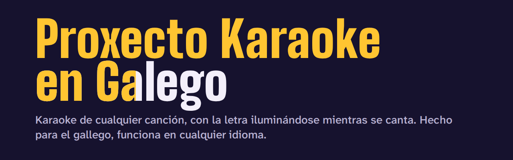
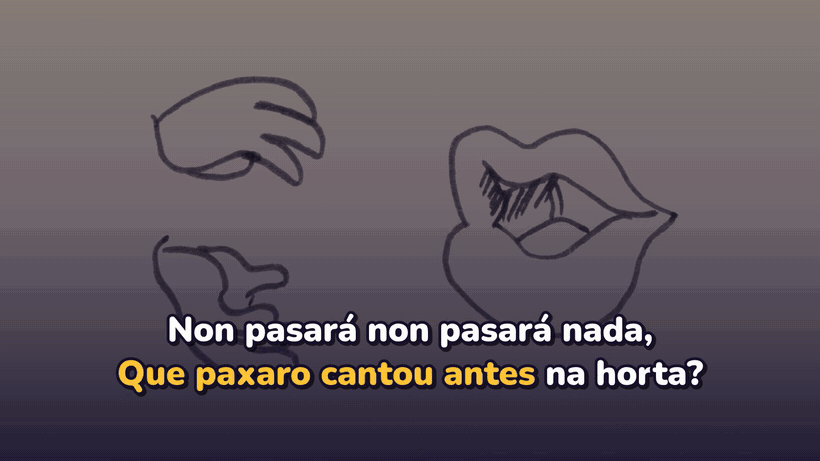
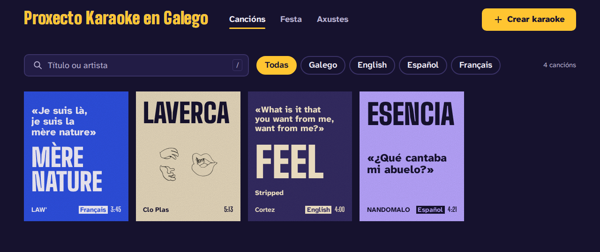
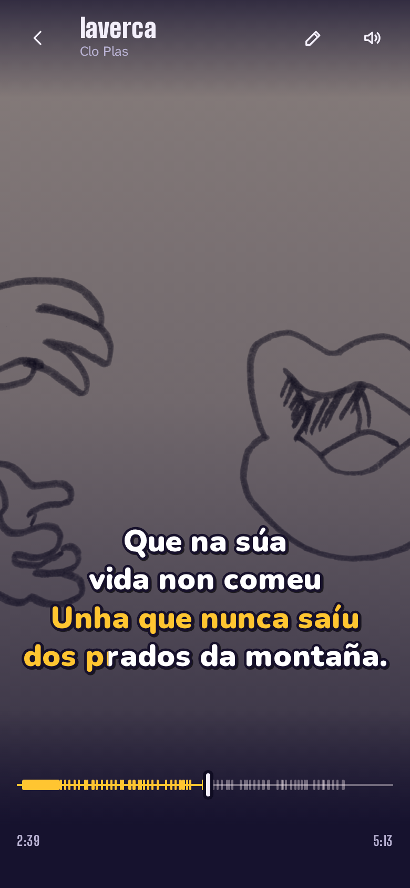
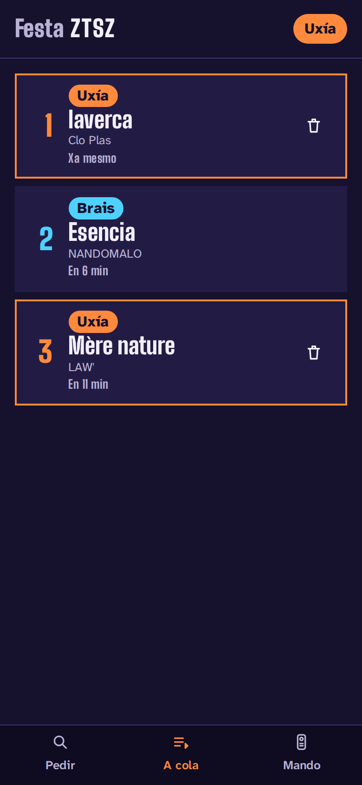
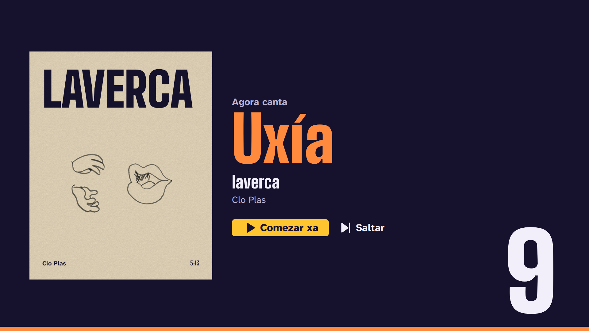
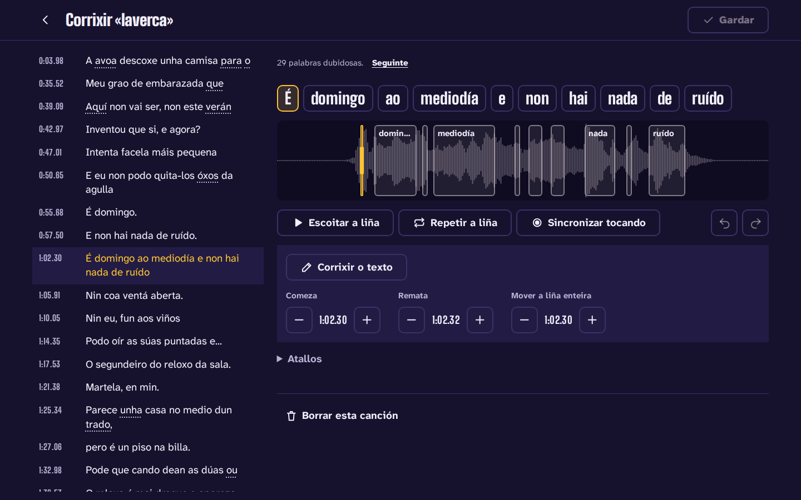
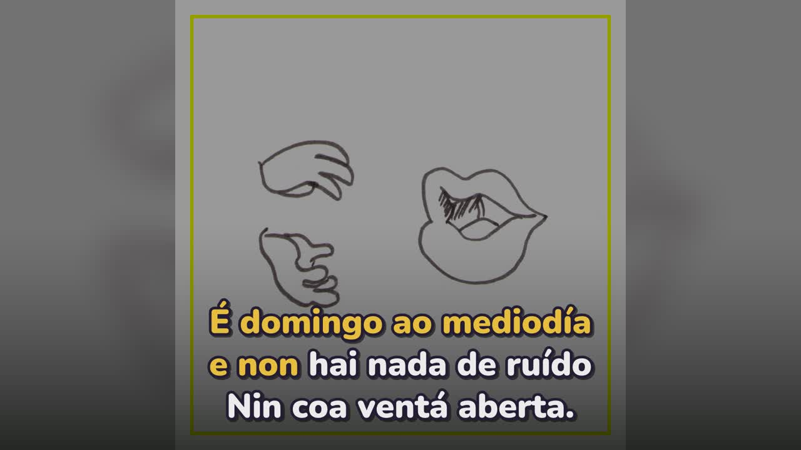
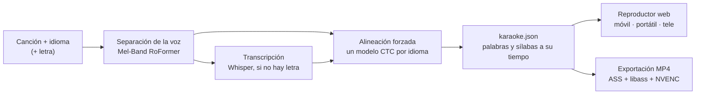

<p align="center">
  
</p>

<p align="center">
  <a href="README.md">Galego</a> | <a href="README.en.md">English</a> | <b>Español</b>
</p>

<p align="center">
  <a href="https://github.com/gaelfernandez1/KaraokeProject/actions/workflows/ci.yml"></a>
  <a href="https://github.com/gaelfernandez1/KaraokeProject/releases"></a>
  <a href="LICENSE"></a>
  
</p>

**Proxecto Karaoke en Galego** convierte cualquier canción en un karaoke en el que la letra se
ilumina palabra a palabra y sílaba a sílaba, justo cuando se canta. Funciona en tu propio ordenador
con una tarjeta gráfica modesta, y se canta desde el móvil, el portátil o la tele. Está hecho
**primero para el gallego** —una lengua que las herramientas generales suelen confundir con el
castellano o el portugués— y **funciona con canciones en cualquier idioma**.

<p align="center">
  
  <br>
  <sub>«laverca», de Clo Plas (CC BY-SA 4.0), sincronizada por el proyecto sin ninguna corrección a mano.</sub>
</p>

## Qué hace

- **Un karaoke de cualquier canción**: sube un archivo o pega un enlace, elige el idioma y, si la
  tienes, pega la letra; si no, puede buscarla en LRCLIB o transcribirla. Con la letra, una
  canción está lista en un minuto y medio, más o menos.
- **La letra a su tiempo**: cada palabra y cada sílaba recibe el momento en que de verdad se canta,
  medido contra la propia voz; los coros tienen sus propias líneas y cada cantante, su color.
- **Primero el gallego**: se usa siempre el idioma que eliges, sin cambiarlo a escondidas; la
  grafía dialectal y la reintegracionista se muestran tal como se escriben, y los pronombres que
  las webs de letras escriben separados se juntan a su verbo.
- **Cualquier otro idioma**: castellano, portugués, inglés, francés y alemán tienen sus propios
  modelos, y los demás —casi 1600— se alinean con un modelo multilingüe. Sin letra, transcribe en
  un centenar de idiomas.
- **Cantar donde quieras**: un reproductor a pantalla completa que va igual en el móvil, en el
  portátil y en la tele por HDMI, con voz guía, tono, compensación del retardo de las teles y de los
  altavoces Bluetooth, y canciones guardadas para cantar sin conexión.
- **Modo fiesta**: la tele muestra un código QR; los invitados piden canciones desde el móvil,
  cantan por turnos y usan el móvil como mando. Sin instalar nada.
- **Corregir en segundos**: un editor de letra y tiempos señala las palabras dudosas, reproduce una
  línea y deja marcar el ritmo tocando la pantalla para resincronizarla, sin volver a procesar la
  canción.
- **Exportar vídeo**: 16:9 para la tele o YouTube y 9:16 para las redes sociales, con la misma
  letra.
- **Privado y gratis**: todo va en tu ordenador; sin cuentas, sin nube y sin pagar nada.

| Biblioteca | En el móvil | Fiesta: el móvil de un invitado |
|---|---|---|
|  |  |  |

| Fiesta en la tele | Editor de la letra | Vídeo exportado |
|---|---|---|
|  |  |  |

La interfaz de la aplicación está en gallego, castellano e inglés.

## Qué tal funciona

Medido con el banco de pruebas del proyecto, con canciones de licencia libre, en una RTX 3050
Laptop (4 GB):

| | Resultado |
|---|---|
| Sincronía con letra, [JamendoLyrics MultiLang](https://github.com/f90/jamendolyrics) (79 canciones en inglés, castellano, francés y alemán) | **98,8 %** de las palabras empiezan a ≤ 0,3 s de la referencia; error medio de 0,093 s ([informe](bench/results/2026-10-29-c4-default-jamendo-lyrics/report.md)) |
| Sincronía con letra, canciones en gallego | **99,8 %** a ≤ 0,3 s ([informe](bench/results/2026-11-06-c9-despois-gl-lyrics/report.md)) |
| Transcripción sin letra (tasa de error de palabras) | 23,2 % en JamendoLyrics y 26,5 % en gallego, frente al 33,7 % y al 35,9 % de una base con Demucs y Whisper |
| Cambios de idioma sin pedirlo | ninguno, en todo el banco |
| Una canción de 4:47 con letra, del archivo al karaoke | unos 85 s |
| Un MP4 1080p de 4 minutos | menos de un minuto |

Cómo funciona el banco y todos los informes: [`docs/benchmark.md`](docs/benchmark.md) (en inglés)
y [`bench/results/`](bench/results/).

## Cómo funciona



El **motor** separa la voz, la transcribe cuando no hay letra y alinea la letra con la voz con un
modelo para cada idioma (el de Proxecto Nós para el gallego; el Omnilingual de Meta para
cualquiera de los casi 1600 que no tienen uno propio). El resultado es un único documento,
`karaoke.json`, que el **reproductor web** y la **exportación de vídeo** dibujan igual. Un
**servidor en casa** pone los trabajos en cola en la GPU, guarda la biblioteca y sirve la
aplicación a todos los aparatos de la casa. Cada modelo se eligió con el banco, y cada paso cabe en
4 GB de memoria de vídeo.

Python 3.12 (uv, FastAPI, PyTorch, faster-whisper), TypeScript (SvelteKit, Web Audio), ffmpeg. La
arquitectura y el porqué de cada decisión: [`docs/architecture.md`](docs/architecture.md) (en
inglés).

## Empezar

Necesitas Linux o Windows 11 con WSL 2 (Ubuntu), Node 22 o superior y ffmpeg. Se recomienda una GPU
NVIDIA de 4 GB; sin ella también funciona, más despacio.

```bash
git clone https://github.com/gaelfernandez1/KaraokeProject.git
cd KaraokeProject
make install      # el motor, el servidor, la aplicación web y los modelos del gallego
make serve
```

Después abre <http://localhost:8765>. `make install` se puede repetir cuando quieras, nunca usa
sudo y termina diciendo lo que aún falta. Para llegar desde los móviles y la tele, y desde fuera de
casa, mira [`docs/server.md`](docs/server.md).

Desde la línea de órdenes:

```bash
uv run karaoke make cancion.mp3 --lyrics letra.txt --lang gl    # un paquete de karaoke
uv run karaoke make song.mp3 --lyrics lyrics.txt --lang en      # en cualquier otro idioma
uv run karaoke render <paquete> --aspect 9:16                   # un vídeo vertical
```

## Documentación

Las guías técnicas están en inglés; el índice está en [`docs/README.md`](docs/README.md). Los
documentos del plan y las decisiones de diseño, en castellano.

- [Arquitectura](docs/architecture.md) y [decisiones de diseño](docs/plan-v3/decisiones/)
- [Preparar el entorno](docs/development.md) y [puertas de calidad](docs/quality.md)
- [Servidor](docs/server.md), [aplicación web](docs/web.md), [audio](docs/audio.md), [sincronía de la letra](docs/lyrics-sync.md), [subtítulos](docs/subtitles.md), [vídeo](docs/video.md)
- [Banco de pruebas](docs/benchmark.md) e [idiomas y modelos](docs/languages-and-models.md)
- [Publicar una versión](docs/releasing.md) y el [registro de cambios](CHANGELOG.md)

## Estado y límites

La versión 3.0 es una reconstrucción completa. Lo que aún no hace:

- Necesita Linux o WSL 2; no hay versión nativa para Windows ni macOS.
- Los cantantes solo se distinguen cuando la letra dice quién canta; aún no hay detección
  automática de voces.
- Sin letra, la transcripción en gallego todavía falla en casi una de cada cuatro palabras: pegar
  la letra da el mejor resultado.
- En la red de casa la aplicación va por HTTP sin cifrar: cambiar el tono y guardar canciones sin
  conexión necesitan `localhost` o HTTPS (por ejemplo, a través de Tailscale).

## Origen

El proyecto nació como Trabajo de Fin de Grado en la Universidade da Coruña en 2025
([la memoria](docs/tfg/memoria-tfg.pdf), en gallego). La versión 3 lo reconstruye desde cero con lo
que aquel trabajo aprendió. Para citarlo, usa [`CITATION.cff`](CITATION.cff) (*Cite this
repository* en GitHub).

## Colaborar

Los informes de errores y las ideas son bienvenidos a través de los
[formularios de issues](https://github.com/gaelfernandez1/KaraokeProject/issues/new/choose). Antes
de un pull request, lee [`CONTRIBUTING.md`](CONTRIBUTING.md) (en inglés). Los problemas de
seguridad se comunican en privado ([`SECURITY.md`](SECURITY.md)).

## Licencia y créditos

El proyecto se publica bajo la [licencia MIT](LICENSE). Se apoya en el trabajo de otras personas:
los modelos de Proxecto Nós, HiTZ, OpenAI, Meta y Kimberley Jensen; las fuentes Big Shoulders,
Atkinson Hyperlegible, Nunito e Inter; y las canciones de artistas que comparten su música
libremente. Sus licencias están en [`NOTICE.md`](NOTICE.md). Las capturas muestran canciones con
licencias Creative Commons y se comparten bajo CC BY-SA 4.0.
