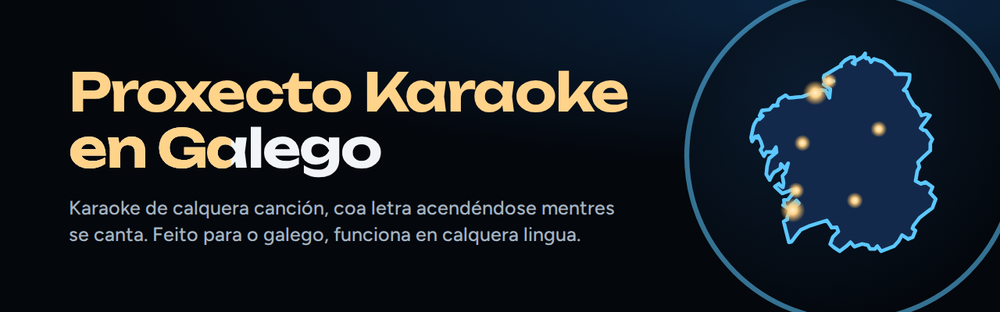
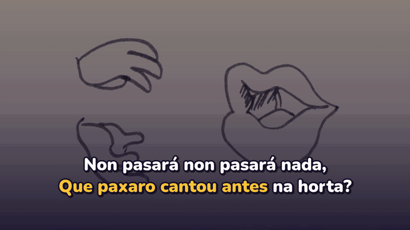
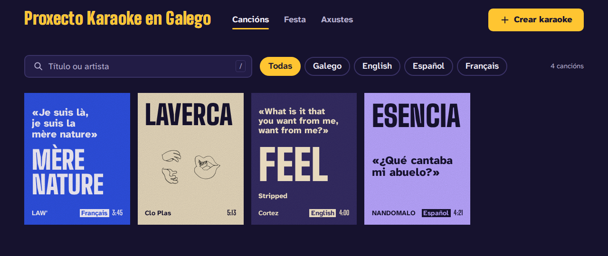
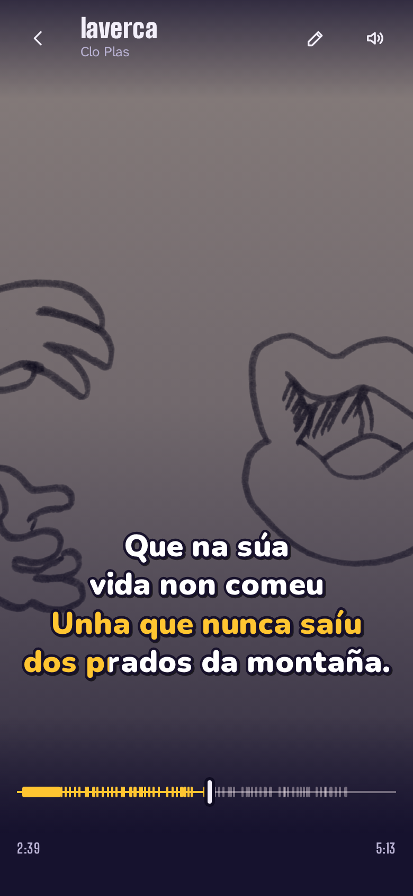
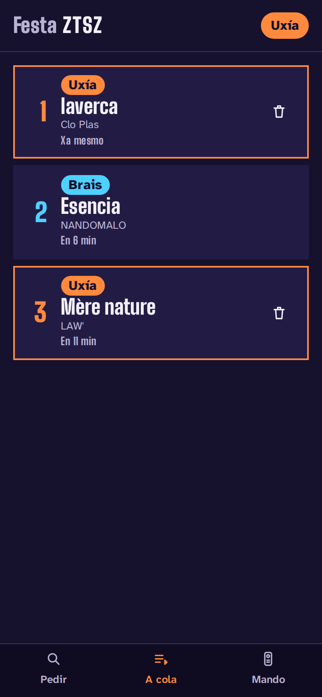
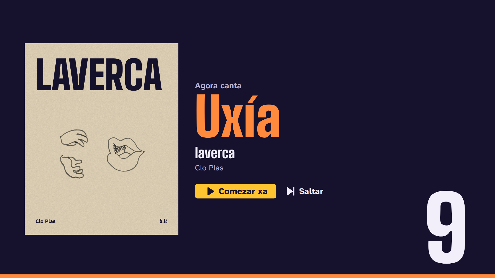
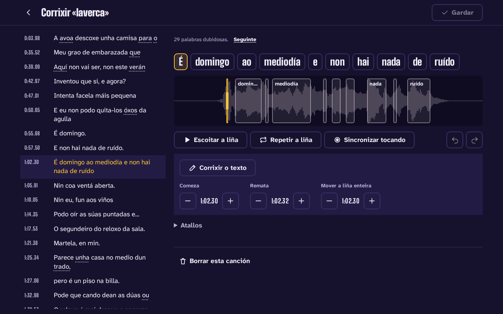
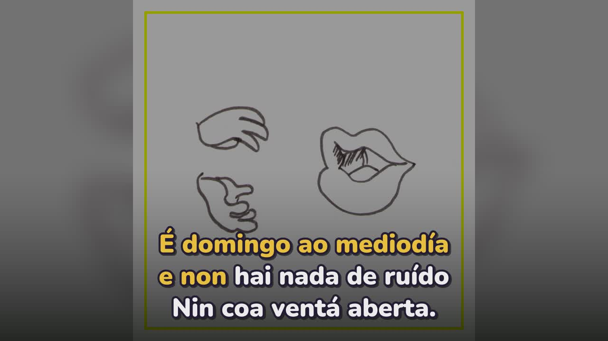
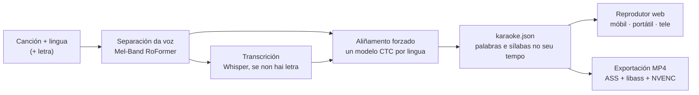

<p align="center">
  
</p>

<p align="center">
  <b>Galego</b> | <a href="README.en.md">English</a> | <a href="README.es.md">Español</a>
</p>

<p align="center">
  <a href="https://github.com/gaelfernandez1/KaraokeProject/actions/workflows/ci.yml"></a>
  <a href="https://github.com/gaelfernandez1/KaraokeProject/releases"></a>
  <a href="LICENSE"></a>
  
</p>

**Proxecto Karaoke en Galego** converte calquera canción nun karaoke no que a letra se acende
palabra a palabra e sílaba a sílaba, xusto cando se canta. Funciona no teu propio ordenador cunha
tarxeta gráfica modesta, e cántase dende o móbil, o portátil ou a tele. Está feito **primeiro para
o galego** —unha lingua que as ferramentas xerais adoitan confundir co castelán ou co portugués— e
**funciona con cancións en calquera lingua**.

<p align="center">
  
  <br>
  <sub>«laverca», de Clo Plas (CC BY-SA 4.0), sincronizada polo proxecto sen ningunha corrección a man.</sub>
</p>

## Que fai

- **Un karaoke de calquera canción**: sobe un ficheiro ou pega unha ligazón, escolle a lingua e,
  se a tes, pega a letra; se non, pode buscala en LRCLIB ou transcribila. Coa letra, unha canción
  está lista en minuto e medio, máis ou menos.
- **A letra no seu tempo**: cada palabra e cada sílaba recibe o momento no que de verdade se canta,
  medido contra a propia voz; os coros teñen as súas propias liñas e cada cantante, a súa cor.
- **Primeiro o galego**: úsase sempre a lingua que escolles, sen cambiala ás agachadas; a grafía
  dialectal e a reintegracionista amósanse tal como se escriben, e os pronomes que as webs de
  letras escriben separados xúntanse ao seu verbo.
- **Calquera outra lingua**: castelán, portugués, inglés, francés e alemán teñen os seus propios
  modelos, e as demais —preto de 1600— aliñan cun modelo multilingüe. Sen letra, transcribe en
  arredor dun cento de linguas.
- **Cantar onde queiras**: un reprodutor a pantalla completa que vai igual no móbil, no portátil e
  na tele por HDMI, con voz guía, ton, compensación do atraso das teles e dos altofalantes
  Bluetooth, e cancións gardadas para cantar sen conexión.
- **Modo festa**: a tele amosa un código QR; os convidados piden cancións dende o móbil, cantan por
  quendas e usan o móbil como mando. Sen instalar nada.
- **Corrixir en segundos**: un editor de letra e tempos sinala as palabras dubidosas, reproduce
  unha liña e deixa marcar o ritmo tocando a pantalla para resincronizala, sen volver procesar a
  canción.
- **Exportar vídeo**: 16:9 para a tele ou YouTube e 9:16 para as redes sociais, coa mesma letra.
- **Privado e de balde**: todo vai no teu ordenador; sen contas, sen nube e sen pagar nada.

| Biblioteca | No móbil | Festa: o móbil dun convidado |
|---|---|---|
|  |  |  |

| Festa na tele | Editor da letra | Vídeo exportado |
|---|---|---|
|  |  |  |

A interface da aplicación está en galego, castelán e inglés.

## Que tal funciona

Medido co banco de probas do proxecto, con cancións de licenza libre, nunha RTX 3050 Laptop
(4 GB):

| | Resultado |
|---|---|
| Sincronía coa letra, [JamendoLyrics MultiLang](https://github.com/f90/jamendolyrics) (79 cancións en inglés, castelán, francés e alemán) | **98,8 %** das palabras comezan a ≤ 0,3 s da referencia; erro medio de 0,093 s ([informe](bench/results/2026-10-29-c4-default-jamendo-lyrics/report.md)) |
| Sincronía coa letra, cancións en galego | **99,8 %** a ≤ 0,3 s ([informe](bench/results/2026-11-06-c9-despois-gl-lyrics/report.md)) |
| Transcrición sen letra (taxa de erro de palabras) | 23,2 % en JamendoLyrics e 26,5 % en galego, fronte ao 33,7 % e ao 35,9 % dunha base con Demucs e Whisper |
| Cambios de lingua sen pedilo | ningún, en todo o banco |
| Unha canción de 4:47 con letra, do ficheiro ao karaoke | uns 85 s |
| Un MP4 1080p de 4 minutos | menos dun minuto |

Como funciona o banco e todos os informes: [`docs/benchmark.md`](docs/benchmark.md) (en inglés) e
[`bench/results/`](bench/results/).

## Como funciona



O **motor** separa a voz, transcríbea cando non hai letra e aliña a letra coa voz cun modelo para
cada lingua (o de Proxecto Nós para o galego; o Omnilingual de Meta para calquera das preto de
1600 que non teñen un propio). O resultado é un só documento, `karaoke.json`, que o **reprodutor
web** e a **exportación de vídeo** debuxan do mesmo xeito. Un **servidor na casa** pon os
traballos en cola na GPU, garda a biblioteca e serve a aplicación a todos os aparellos da casa.
Cada modelo escolleuse co banco, e cada paso cabe en 4 GB de memoria de vídeo.

Python 3.12 (uv, FastAPI, PyTorch, faster-whisper), TypeScript (SvelteKit, Web Audio), ffmpeg. A
arquitectura e o porqué de cada decisión: [`docs/architecture.md`](docs/architecture.md) (en
inglés).

## Comezar

Precisas Linux ou Windows 11 con WSL 2 (Ubuntu), Node 22 ou superior e ffmpeg. Recoméndase unha GPU
NVIDIA de 4 GB; sen ela tamén funciona, máis amodo.

```bash
git clone https://github.com/gaelfernandez1/KaraokeProject.git
cd KaraokeProject
make install      # o motor, o servidor, a aplicación web e os modelos do galego
make serve
```

Despois abre <http://localhost:8765>. `make install` pódese repetir cando queiras, nunca usa sudo e
remata dicindo o que aínda falta. Para chegar dende os móbiles e a tele, e dende fóra da casa, mira
[`docs/server.md`](docs/server.md).

Dende a liña de ordes:

```bash
uv run karaoke make cancion.mp3 --lyrics letra.txt --lang gl    # un paquete de karaoke
uv run karaoke make song.mp3 --lyrics lyrics.txt --lang en      # en calquera outra lingua
uv run karaoke render <paquete> --aspect 9:16                   # un vídeo vertical
```

## Documentación

As guías técnicas están en inglés; o índice está en [`docs/README.md`](docs/README.md). Os
documentos do plan e as decisións de deseño, en castelán.

- [Arquitectura](docs/architecture.md) e [decisións de deseño](docs/plan-v3/decisiones/)
- [Preparar o contorno](docs/development.md) e [portas de calidade](docs/quality.md)
- [Servidor](docs/server.md), [aplicación web](docs/web.md), [audio](docs/audio.md), [sincronía da letra](docs/lyrics-sync.md), [subtítulos](docs/subtitles.md), [vídeo](docs/video.md)
- [Banco de probas](docs/benchmark.md) e [linguas e modelos](docs/languages-and-models.md)
- [Publicar unha versión](docs/releasing.md) e o [rexistro de cambios](CHANGELOG.md)

## Estado e límites

A versión 3.0 é unha reconstrución completa. O que aínda non fai:

- Precisa Linux ou WSL 2; non hai versión nativa para Windows nin macOS.
- Os cantantes só se distinguen cando a letra di quen canta; aínda non hai detección automática
  de voces.
- Sen letra, a transcrición en galego aínda erra preto dunha palabra de cada catro: pegar a letra
  dá o mellor resultado.
- Na rede da casa a aplicación vai por HTTP sen cifrar: cambiar o ton e gardar cancións sen
  conexión precisan `localhost` ou HTTPS (por exemplo, a través de Tailscale).

## Orixe

O proxecto naceu como Traballo de Fin de Grao na Universidade da Coruña en 2025
([a memoria](docs/tfg/memoria-tfg.pdf)). A versión 3 reconstrúeo dende cero co que aquel traballo
aprendeu. Para citalo, usa [`CITATION.cff`](CITATION.cff) (*Cite this repository* en GitHub).

## Colaborar

Os informes de erros e as ideas son benvidos a través dos
[formularios de issues](https://github.com/gaelfernandez1/KaraokeProject/issues/new/choose). Antes
dun pull request, le [`CONTRIBUTING.md`](CONTRIBUTING.md) (en inglés). Os problemas de seguridade
comunícanse en privado ([`SECURITY.md`](SECURITY.md)).

## Licenza e créditos

O proxecto publícase baixo a [licenza MIT](LICENSE). Apóiase no traballo doutras persoas: os
modelos de Proxecto Nós, HiTZ, OpenAI, Meta e Kimberley Jensen; as fontes Big Shoulders, Atkinson
Hyperlegible, Nunito e Inter; e as cancións de artistas que comparten a súa música libremente. As
súas licenzas están en [`NOTICE.md`](NOTICE.md). As capturas amosan cancións con licenzas Creative
Commons e compártense baixo CC BY-SA 4.0.
