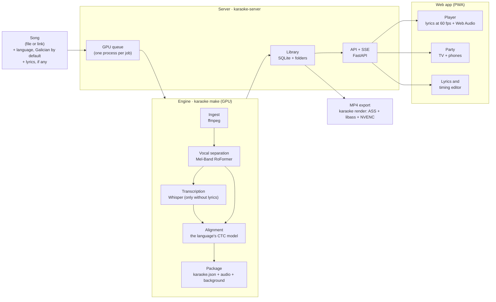

# Architecture

How Proxecto Karaoke en Galego is built, from the song that comes in to the lyrics that light up
on the TV. Every choice has its reasons, with what was measured and what was discarded, in the
[decisions](plan-v3/decisiones/) (in Spanish; summary at the end).

## At a glance



The lyrics are timed **once**, in `karaoke.json`, and drawn in two places: the web player (the main
experience, on a phone, a laptop and a TV) and the MP4 (an export).

## Galician first, any language

Galician sets the bar: it has its own models (Proxecto Nós for alignment, HiTZ for transcription),
its own rules (numbers, syllables, enclitic pronouns) and its own songs in the benchmark. Every other
language works with the same pipeline: six have a dedicated alignment model, any of some 1,600 is
aligned with Meta's Omnilingual model, and Whisper transcribes about a hundred. What each language
gets: [`languages-and-models.md`](languages-and-models.md).

## The pieces

| Piece | What it does | Code | Command | Guide |
|---|---|---|---|---|
| Contracts | the `karaoke.json` and `theme.json` models, validation and JSON Schema | `packages/contracts` | — | [`plan-v3/decisiones/002-contratos-v0.md`](plan-v3/decisiones/002-contratos-v0.md) |
| Engine | separation, transcription, alignment, syllables, the package's audio, ASS subtitles and video | `packages/engine` | `karaoke` | [`audio.md`](audio.md), [`lyrics-sync.md`](lyrics-sync.md), [`subtitles.md`](subtitles.md), [`video.md`](video.md) |
| Server | API, GPU queue, library, paired devices, party, backups | `packages/server` | `karaoke-server` | [`server.md`](server.md) |
| Web app | library, player, create, party, editor and settings, in Galician, Spanish and English | `web/` | — | [`web.md`](web.md) |
| Benchmark | measures transcription, timing, speed and memory with freely licensed songs | `packages/bench`, `bench/` | `karaoke-bench` | [`benchmark.md`](benchmark.md) |

The boundaries are enforced by `make lint` (import-linter): contracts → engine → bench and server,
with no upward imports, and **the server process never imports torch or the models**: only each
job's child process loads them. That way a model running out of memory does not take the API down.

## The engine, step by step

`karaoke make <song> [--lyrics lyrics.txt] [--lang gl]` makes a package. With a 4 GB GPU, one
model at a time: each step frees its memory before the next one loads its own.

1. **Ingest**: ffmpeg decodes any audio or video format. If it has video, a web-ready
   `background.mp4` is kept; if it has artwork, `cover.jpg`.
2. **Separation**: Kim's Mel-Band RoFormer vocal model through audio-separator, in 8 s chunks (about
   3 GB of VRAM). The separated voice is what gets aligned and the player's guide vocals.
3. **Transcription**, only when there are no lyrics (or `--lrclib` finds none): Whisper on the
   separated voice, always in the language asked for. HiTZ `whisper-large-v3-gl` for Galician,
   large-v3-turbo for the rest; it drops the stretches where the voice is silent and the loops
   Whisper makes up.
4. **Alignment**: the language's CTC model (Proxecto Nós for Galician; Omnilingual for those without
   their own) and a search that allows fillers between lines (ad-libs, backing vocals not in the
   lyrics), skipping lines nobody sings, and that penalises placing lyrics where the voice is silent.
   Then it fits the ends to the voice, splits the words into timed syllables (Galician, Spanish and
   Portuguese), gives each word a confidence and, in Galician, joins pronouns written apart to their
   verb.
5. **Package**: `karaoke.json`, the instrumental and the vocals in m4a at −14 LUFS (measured and
   encoded while the GPU aligns), the background and the cover.

The language never changes on its own: detection only suggests, and if a resource is missing for a
language, the best available is used and noted in `provenance.language_fallbacks`.

## The karaoke package

One folder per song. The document validates against
[`schemas/karaoke.schema.json`](../schemas/karaoke.schema.json) (version 1.2.0), generated from the
pydantic models, like the web app's TypeScript types (`make contracts`).

```
<id>/
  karaoke.json       lyrics: lines, words and syllables with their timings and confidence
  instrumental.m4a   without the lead vocals
  vocals.m4a         the guide vocals
  background.mp4     optional: the song's video, web-ready (720p)
  master.mp4         optional: the same video at its own quality (up to 1080p), for the MP4 export
  cover.jpg          optional: the cover
  exports/           the karaoke MP4 files made by the server, with their thumbnails
```

Each line has its singer and its role (`lead` or `backing`: backing vocals may overlap the lead
line). `provenance` says where the lyrics came from and which models were used.

## The server

- **One process** (uvicorn) with two doors: `0.0.0.0:8765` for the home and `127.0.0.1:8766` for a
  tunnel (Tailscale Serve, with HTTPS). It serves the API, the packages' files (with `Range`
  requests) and the built web app.
- **Zones**: the laptop itself is the owner; a phone at home browses, sings and runs parties; from
  outside only devices paired with a one-time code get in. Details in
  [`../SECURITY.md`](../SECURITY.md).
- **Jobs**: uploads are streamed to disk; links go through yt-dlp at its latest release; the GPU
  does one job at a time, in a child process inside a systemd scope with a memory limit, which
  reports in JSON lines. Progress and time left reach the web app through SSE; cancelling frees the
  GPU in under a second.
- **Data** in `~/.local/share/karaoke/`: SQLite (jobs, devices, parties), one folder per song, a
  30-day trash, logs and backups.

## The web app

SvelteKit in SPA mode, served by the server itself and installable (a PWA, with songs saved to sing
offline). The API client uses types generated from the server's OpenAPI.

- **Player**: an audio engine on Web Audio plays the instrumental and the guide vocals together,
  with guide-vocal volume, pitch shifting (signalsmith-stretch in an AudioWorklet) and compensation
  for the delay of the TV or a Bluetooth speaker. Its clock, `now()`, already compensated, drives the
  lyrics.
- **Lyrics**: a layout that exists twice, in Python (for the MP4) and in TypeScript (for the web),
  with shared test cases that force both to break lines in the same place. The web paints with the
  DOM at 60 fps; the MP4, with ASS events (`\kf` per syllable) drawn by libass. Measured side by side,
  they agree within 1–3 px.
- **Party**: the TV shows a QR code; phones ask for songs, queue by turns and act as a remote (guide
  vocals, pitch, pause).
- **Editor**: correct a word or a timing in seconds, listen to the line and re-time it by tapping
  along; it saves without processing the song again.

## What shapes the design

- **An RTX 3050 with 4 GB and about 7 GB of RAM in WSL**: one model on the GPU at a time, in int8 or
  float16, and never two processes with models at once.
- **Local first and free**: the laptop processes and serves; nothing leaves the house unless the
  user asks (a link, looking up lyrics on LRCLIB).
- **Measure before choosing**: every model and every engine parameter was chosen with the benchmark
  ([`benchmark.md`](benchmark.md)), and every change to quality or speed is measured again.

## Numbers (RTX 3050 Laptop, 4 GB)

| What | Result | Source |
|---|---|---|
| Timing with lyrics, JamendoLyrics (79 songs, 4 languages) | 98.8 % of words start within 0.3 s; mean error 0.093 s | [report](../bench/results/2026-10-29-c4-default-jamendo-lyrics/report.md) |
| Timing with lyrics, Galician (5 songs) | 99.8 % within 0.3 s | [report](../bench/results/2026-11-06-c9-despois-gl-lyrics/report.md) |
| Transcription without lyrics (WER) | 23.2 % on JamendoLyrics; 26.5 % in Galician | [decision 005](plan-v3/decisiones/005-sincronia.md) |
| Silent language switches | none in the whole benchmark | [decision 005](plan-v3/decisiones/005-sincronia.md) |
| Making a 4:47 karaoke with lyrics | about 85 s | [report](../bench/results/2026-11-06-c9-calidad/) |
| Exporting a 4-minute 1080p MP4 | under a minute with NVENC | [report](../bench/results/2026-10-30-c6-render/report.md) |
| Lyrics animation | 60 fps with the CPU slowed down ×6 | [`quality.md`](quality.md) |

## Decisions (in Spanish)

| No. | Topic | In one line |
|---|---|---|
| [000](plan-v3/decisiones/000-plan-v3.md) | Plan v3 | the rebuild replaces the v2 system |
| [001](plan-v3/decisiones/001-estructura-y-herramientas.md) | Structure | a uv and SvelteKit monorepo; Python 3.12; strict mypy; make |
| [002](plan-v3/decisiones/002-contratos-v0.md) | Contracts | `karaoke.json` and `theme.json` with pydantic, JSON Schema and TS types |
| [003](plan-v3/decisiones/003-banco-y-metas.md) | Benchmark and goals | JamendoLyrics and free Galician songs; goals set from measurements |
| [004](plan-v3/decisiones/004-audio.md) | Audio | Mel-Band RoFormer in 8 s chunks; −14 LUFS in m4a; the web audio engine |
| [005](plan-v3/decisiones/005-sincronia.md) | Timing | our own CTC aligner per language; Whisper HiTZ for Galician |
| [006](plan-v3/decisiones/006-coros.md) | Backing vocals | `backing` lines that may overlap (contract 1.1.0) |
| [007](plan-v3/decisiones/007-subtitulos.md) | Subtitles | one layout in Python and TS; themes with OFL fonts |
| [008](plan-v3/decisiones/008-video.md) | Video | ASS + libass + NVENC; video, cover or gradient backgrounds |
| [009](plan-v3/decisiones/009-pronomes.md) | Pronouns | Galician enclitics written apart are joined to the verb |
| [010](plan-v3/decisiones/010-frontend.md) | Web app | posters, amber for "sung", a party with nothing to install |
| [011](plan-v3/decisiones/011-servidor.md) | Server | one process, one GPU queue, network zones |
| [012](plan-v3/decisiones/012-calidad.md) | Quality | gates per class of bug; about 40 bugs fixed with tests |
| [013](plan-v3/decisiones/013-proyecto-profesional.md) | Project | one version, releases from the changelog, licences checked |
| [014](plan-v3/decisiones/014-descargas-y-video-original.md) | Downloads | a download panel in the player; the export draws on the original video (contract 1.2.0) |
